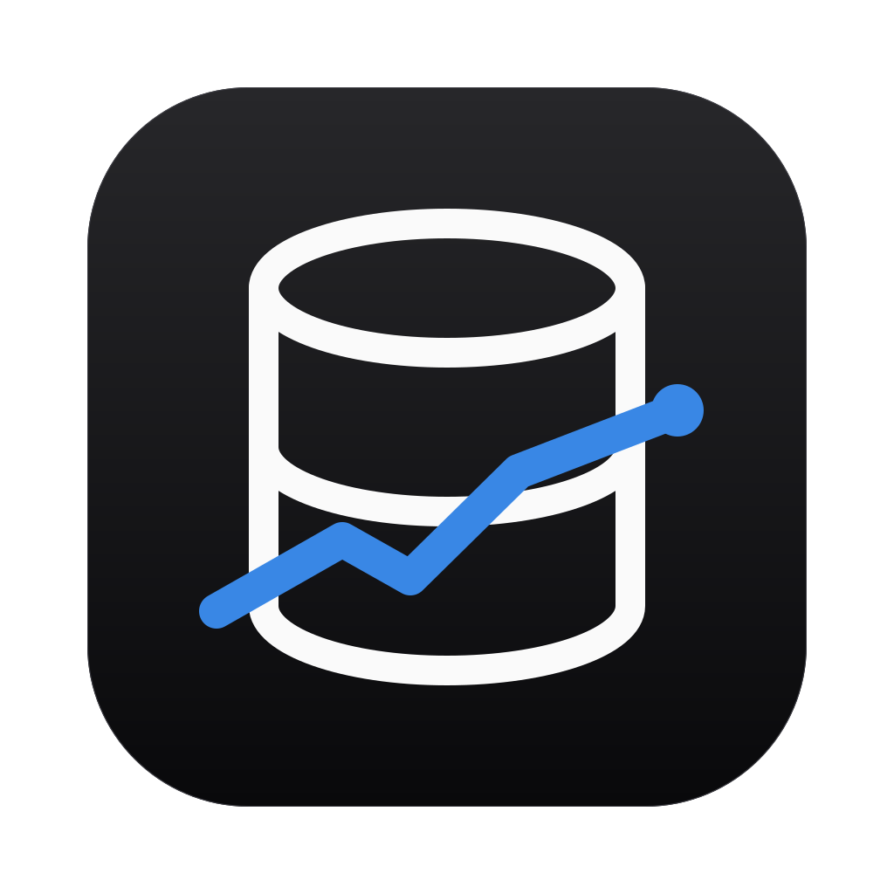
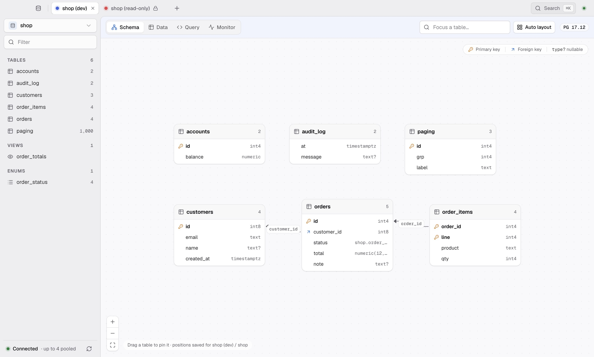
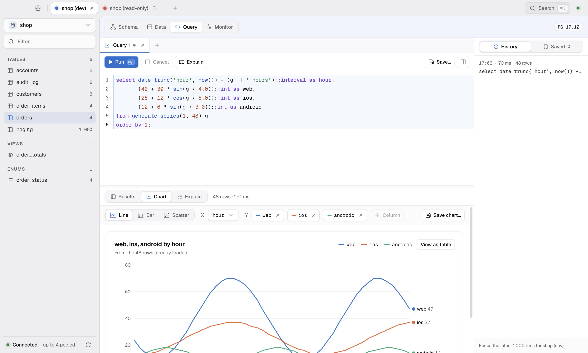
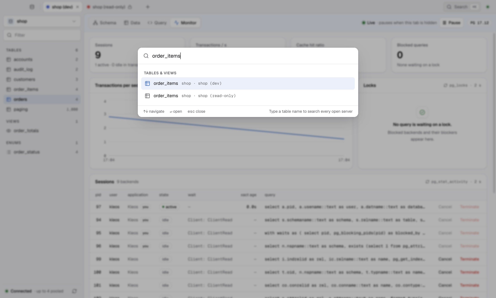
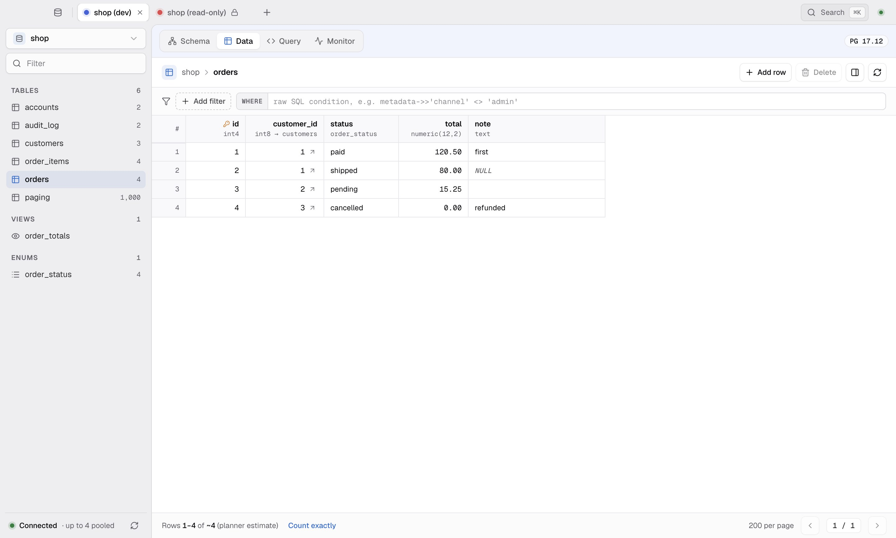
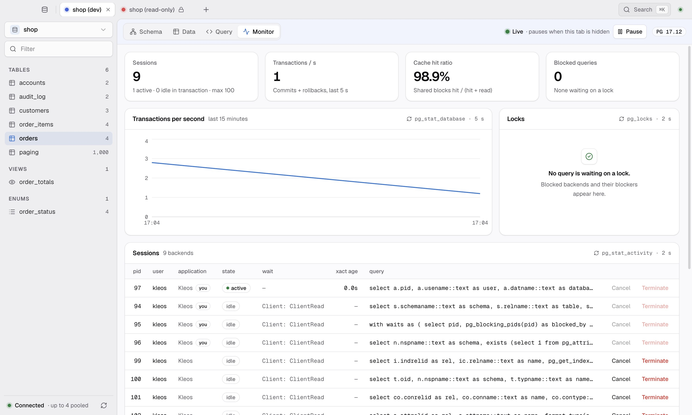
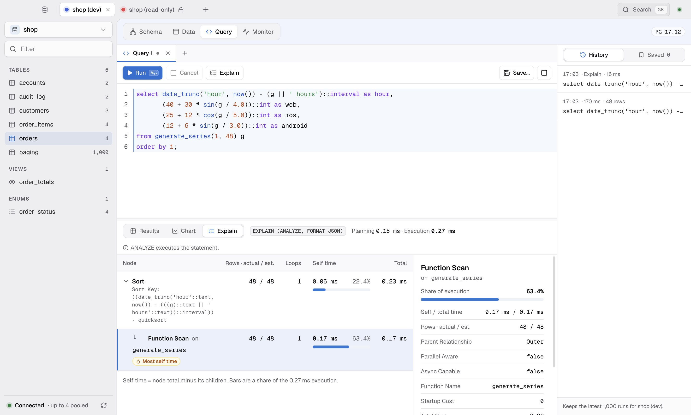
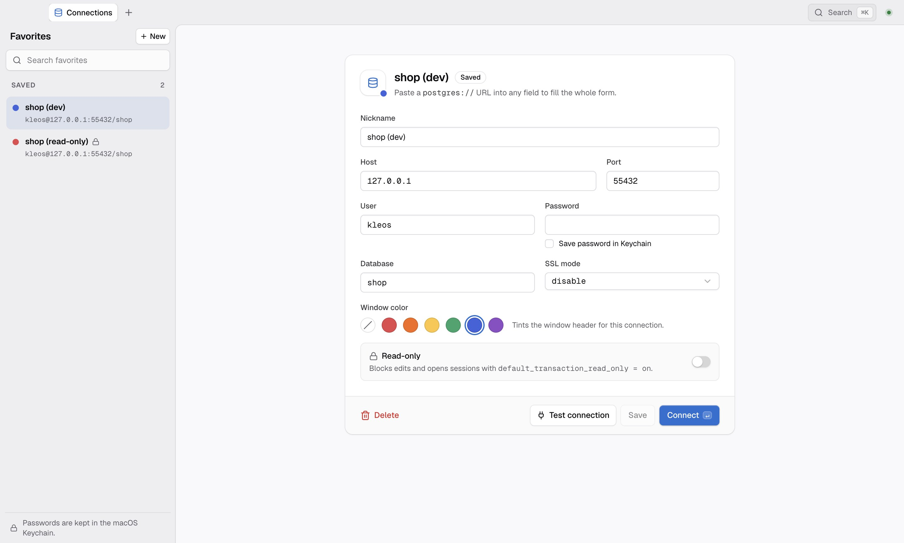
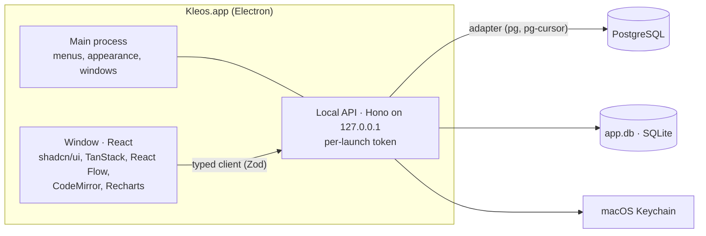

<div align="center">



# Kleos

**A calm, native-feeling Postgres client for the Mac.**

Browse your schema as a diagram, edit rows safely, query with charts and explain plans,
and watch your server live — one window, one tab per server.

[](https://github.com/ArnaudFeelbat/kleos/actions/workflows/ci.yml)


<br />

<picture>
  <source media="(prefers-color-scheme: dark)" srcset="docs/screenshots/schema-dark.jpg" />
  
</picture>

</div>

## Highlights

- **One window, a tab per server.** Connect to as many servers as you like; each keeps its
  queries, pending edits and diagram while you work elsewhere. ⌘1–⌘9 to jump between them.
- **⌘K to go anywhere.** Find any table or view on every open server, a saved query, a
  favorite to connect, or an action — by typing a few letters.
- **Schema as a diagram.** Tables, columns and foreign keys laid out automatically; drag
  tables where you want them and Kleos remembers.
- **Edits you review before they run.** Changes are staged, shown as the exact SQL, and
  committed in one transaction — or none of it is.
- **Exact values, always.** Every value travels as text with its type, so `bigint`,
  `numeric` and `timestamptz` are never rounded or shifted.
- **Queries with charts and plans.** CodeMirror editor with schema autocomplete, paged
  results, line/bar/scatter charts, `EXPLAIN ANALYZE` as a tree, errors underlined where
  Postgres points.
- **Live monitoring.** Sessions, locks and who blocks whom, throughput, cache hit ratio,
  table health, index usage and slow queries — cancel or terminate a backend in two clicks.
- **Any server, any route.** Connect through an SSH tunnel (ssh-agent or a key file), or
  over TLS checked against your own CA. Kleos trusts an SSH host on first use and refuses
  it if its key changes.
- **Data in, data out.** Export a filtered table or a query's full result to CSV, JSON or
  Excel, streamed straight to disk. Import a CSV with a preview and column mapping, in one
  transaction — a bad line is named, and nothing is half-imported.
- **Pick up where you left off.** Relaunch and your servers and query tabs come back.
- **Read-only that means it.** Read-only favorites are enforced by Postgres itself; nothing
  typed in the editor can turn writes back on.
- **Made for macOS.** Translucent sidebar, light and dark appearance (or follow the
  system), native menus and shortcuts, passwords in the Keychain.

## A closer look

<table>
  <tr>
    <td width="50%"><br /><sub><b>Query & chart</b> — run the statement under the cursor, chart the rows you loaded.</sub></td>
    <td width="50%"><br /><sub><b>⌘K palette</b> — one search across every open server.</sub></td>
  </tr>
  <tr>
    <td><br /><sub><b>Data</b> — filters, sorting, foreign-key links, staged edits.</sub></td>
    <td><br /><sub><b>Monitor</b> — live sessions, locks and throughput.</sub></td>
  </tr>
  <tr>
    <td><br /><sub><b>Explain</b> — the plan as a tree, with self time per node.</sub></td>
    <td><br /><sub><b>Connections</b> — paste a <code>postgres://</code> URL to fill the form.</sub></td>
  </tr>
</table>

## Install

1. Download the latest **`Kleos-x.y.z-arm64.dmg`** from
   [Releases](https://github.com/ArnaudFeelbat/kleos/releases) and drag Kleos to Applications.
2. Builds are not notarized yet, so macOS asks before the first launch: right-click Kleos ›
   **Open** › **Open**. (Or once: `xattr -dr com.apple.quarantine /Applications/Kleos.app`.)

Requires macOS on Apple silicon and PostgreSQL 12 or later.

## Keyboard shortcuts

| Shortcut  | Action                                               |
| --------- | ---------------------------------------------------- |
| ⌘K        | Command palette                                      |
| ⌘T        | Connections (open another server)                    |
| ⌘W        | Close the current tab                                |
| ⌘1 … ⌘9   | Go to a server tab (⌘9 = last)                       |
| ⌘⇧] / ⌘⇧[ | Next / previous tab                                  |
| ⌘⇧L       | Toggle light / dark                                  |
| ⌘↵        | Run the selection, or the statement under the cursor |
| ⌘E        | Explain                                              |
| ⌘S        | Commit staged edits (Data) · Save the query (Query)  |
| ⌥← / ⌥→   | Move the selected column                             |

## Privacy and security

- Everything stays on your Mac. Kleos talks only to the databases you connect to.
- The app runs a small API server on `127.0.0.1` for its own window, protected by a random
  token generated at each launch and a Host check.
- Passwords and SSH key passphrases live in the **macOS Keychain** (service `kleos`), never
  in Kleos's own files. Favorites, layouts, history, saved queries, open tabs and trusted
  SSH host keys are in `~/Library/Application Support/Kleos/app.db`.
- Exports are written only to the file you pick in the save dialog; imports read only the
  file you pick.
- SQL is never built from your input: identifiers are quoted and values sent as
  parameters. The raw `WHERE` box and the query editor run exactly what you type — on
  read-only favorites inside a read-only transaction.

See [SECURITY.md](SECURITY.md) to report a vulnerability.

## Development

**Requirements:** macOS, Node 24, pnpm 11, and Docker for the database tests
(OrbStack works; the test helper finds its socket).

```sh
pnpm install            # also rebuilds better-sqlite3 for Electron
pnpm dev                # the app with live reload
pnpm typecheck
pnpm lint
pnpm test               # shared + web + server (server suites start Postgres in Docker)
pnpm package            # apps/desktop/release/Kleos-<version>-arm64.dmg
```

Two scripts drive the built app over the Chrome DevTools Protocol:
`node scripts/smoke.mjs` checks that the window answers, and `node scripts/ui-tour.mjs`
walks every screen against a Postgres you name and saves screenshots (it uses its own
profile, so your installed Kleos is never touched).

### Architecture



| Path              | What it is                                                            |
| ----------------- | --------------------------------------------------------------------- |
| `apps/desktop`    | Electron main + preload (electron-vite), packaging (electron-builder) |
| `packages/server` | Local API: Postgres adapter, SQLite app store, Keychain, routes       |
| `packages/web`    | The interface: React, Tailwind 4, shadcn/ui                           |
| `packages/shared` | Zod schemas for the API, the route table, SQL helpers                 |
| `docs/`           | Product spec, design artboards, screenshots                           |

The product spec lives in [docs/SPEC.md](docs/SPEC.md) and the original design
artboards in [docs/design](docs/design).

## Roadmap

Ideas for the next releases — subject to change:

- Signed and notarized builds with automatic updates
- Schema diff between two open servers · schema editing with SQL preview
- SQL formatting, query parameters, “Run all”

## Changelog

Release notes are written in French: see [CHANGELOG.md](CHANGELOG.md).

## Contributing

Issues and pull requests are welcome — read [CONTRIBUTING.md](CONTRIBUTING.md) first.
